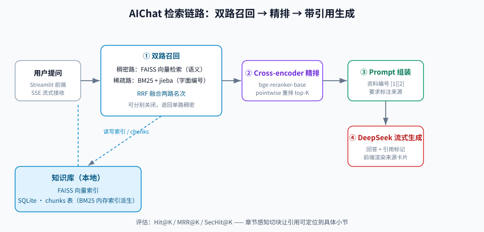
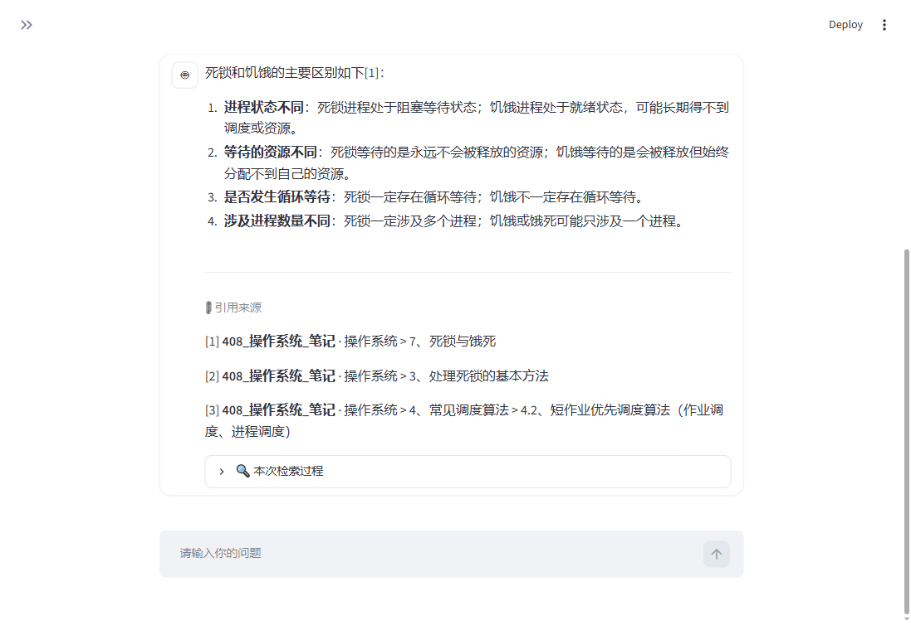
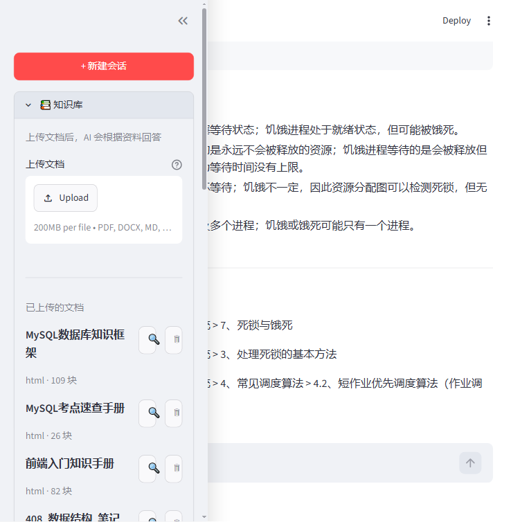

# 基于 RAG 的本地知识库 AI 问答助手

基于 **FastAPI + Streamlit + DeepSeek + RAG** 的本地 AI 问答助手。支持多会话聊天、流式输出，以及上传 PDF / Word / Markdown / 文本 / HTML 构建本地知识库（向量检索问答，回复带引用来源），并内置一套可复跑的检索评估，用来量化「知识库检索准不准」。



| 聊天界面（回答带章节级引用） | 知识库管理（多格式文档入库） |
|---|---|
|  |  |

## 功能特性

- 💬 **多会话聊天**：会话自动保存到本地 SQLite，刷新页面不丢失，支持新建 / 切换 / 删除
- ⚡ **流式输出**：AI 回复逐字显示，无需等待完整生成
- 📚 **多格式知识库**：支持 PDF / Word(.docx) / Excel(.xlsx/.xlsm) / Markdown / txt / HTML(.html/.htm) 上传，自动解析、切块、向量化并建索引
- 📷 **扫描件 PDF 自动 OCR**：文字层为空的页自动用 PyMuPDF 渲染成图，走 RapidOCR 识别文字；OCR 库未装或失败时自动降级为 `needs_ocr`，主流程不中断
- 📊 **Excel 表格解析**：每个工作表转成一个 Markdown 表格块，sheet 名作为章节路径（`工作表: <sheet名>`），行列关系保留给大模型读
- 🔖 **页码与章节定位**：解析时保留每块的来源页码（PDF）与章节路径（PDF / Word / Markdown / txt / HTML 全格式），是引用定位的底层支撑
- 📎 **回答带引用**：模型在关键信息后用 `[1]` `[2]` 标注来源，回复下方展示「引用来源」（文档标题 · 章节 · 页码），让答案可回查、可验证
- 🧠 **本地向量化**：使用 `BAAI/bge-small-zh-v1.5` 本地 embedding 模型，不依赖额外 API；索引懒加载并落盘，重启后自动恢复
- 🎯 **两阶段检索（重排序）**：FAISS 先粗召回候选，再用 Cross-encoder（`BAAI/bge-reranker-base`）精排出最终结果——先找全、再排准；模型不可用时自动退回向量顺序，不影响主流程
- 🔀 **混合检索（BM25 + 向量）**：向量管语义、BM25 管字面（`E102` / `AUTH-1003` 这类无语义编号，向量会平滑掉，字面匹配能治），两路各召回一批候选，稠密路先精排、再与 BM25 路用 RRF 融合（平局以 BM25 名次裁决）；BM25 索引从 `chunks` 表现场派生、只在内存、脏标记失效，不新增持久化；可开关、可降级
- 🧹 **文档管理**：列表查看、分块预览、删除文档（数据库与向量库同步清理，不会残留漂移数据）
- 🔁 **重复检测**：按内容指纹（SHA-256）识别重复文档，相同内容不重复入库
- 🔍 **检索评估**：内置评估集与指标（`Hit@K` / `MRR@K`），并支持章节级指标（`SecHit@K` / `SecMRR@K`），量化「引用定位准不准」；独立内存索引，反复评估不污染真实知识库；含**第三方真实语料外部验证**（医学题库 100 题，黑盒防过拟合）
- 🇨🇳 **国内镜像**：模型下载自动走 HuggingFace 国内镜像（`hf-mirror.com`），无需科学上网

## 技术栈

| 部分 | 技术 |
|---|---|
| 后端 | Python · FastAPI · Uvicorn |
| 前端 | Streamlit |
| 大模型 | DeepSeek（OpenAI 兼容接口） |
| 引用来源 | 检索块的 metadata（title / section_path / page_no）→ 流末尾附加标记 `__CITATIONS_JSON__` → 前端解析展示（零新依赖） |
| 文档解析 | pdfplumber（PDF 矢量文字与表格）· python-docx（Word）· openpyxl（Excel 逐 sheet 转 Markdown）· 正则（Markdown / txt）· 标准库 html.parser（HTML） |
| 扫描件 OCR | PyMuPDF（页面渲染为图）· RapidOCR（onnxruntime 中文识别）；软依赖，未装自动降级为 needs_ocr |
| 文本切分 | 章节 / 页码感知切分 + LangChain RecursiveCharacterTextSplitter（500/50） |
| 向量检索 | LangChain · FAISS · sentence-transformers |
| 重排序 | Cross-encoder（`BAAI/bge-reranker-base`，与 embedding 同为 bge 系列）· 两阶段「向量召回 → 精排」，可开关、可降级 |
| 混合检索 | BM25（`rank_bm25` 纯 Python 实现，内存索引从 `chunks` 表派生）· `jieba` 中文分词 · RRF（Reciprocal Rank Fusion）融合「向量 + BM25」两路召回，可开关、可降级、零新增持久化 |
| 检索评估 | 独立内存 FAISS 索引 · `Hit@K` / `MRR@K` / `SecHit@K` / `SecMRR@K`（纯 Python 实现，无额外依赖） |
| 存储 | SQLite（messages / documents / chunks 三表）· 本地向量索引（faiss_store/） |

## 目录结构

```
AIChat/
├── backend.py            # 后端入口壳：暴露 app，启动命令仍是 uvicorn backend:app
├── frontend.py           # Streamlit 前端界面
├── app/
│   ├── main.py           # FastAPI 装配：中间件、异常兜底、路由注册
│   ├── core/             # config.py（配置与密钥校验）· logging.py
│   ├── db/               # connection.py · schema.py（messages / documents / chunks 三表）
│   ├── models/           # schemas.py（请求数据契约）
│   ├── routers/          # chat.py（聊天 / 会话）· knowledge.py（知识库）
│   └── services/
│       ├── parsing/      # 文档解析层：base / pdf(+OCR) / docx / xlsx / markdown / plain / html / ocr
│       ├── chunking.py   # 章节感知切分
│       ├── documents.py  # 文档入库 / 查询 / 删除（表与向量库同步）
│       ├── vector_store.py   # FAISS 懒加载与落盘
│       ├── embeddings.py # 本地 embedding 模型
│       ├── rerank.py     # Cross-encoder 重排序（懒加载 + 可降级）
│       ├── bm25.py       # BM25 稀疏召回 + RRF 融合（内存索引，脏标记失效）
│       ├── rag.py        # 三阶段检索 + prompt 组装 + 引用元数据
│       ├── llm.py        # DeepSeek 客户端
│       └── chat_history.py   # 会话与消息
├── eval/                 # 检索评估（独立于线上知识库）
│   ├── run_eval.py       # 评估入口：建内存索引 → 跑标注集 → 出指标
│   ├── build_medical_corpus.py  # 医学题库预处理：无标题结构 → Heading（外部验证用）
│   ├── corpus/           # 合成语料（6 篇，覆盖多种排版）
│   ├── corpus_real/      # 真实文档（Markdown 版）
│   ├── corpus_real_txt/  # 真实文档（txt 版）
│   ├── corpus_kb/        # 与当前知识库一一对应的语料（3 篇）
│   ├── corpus_dup/       # 近重复对抗语料（3 对同模板、仅编号/数字不同的文档）
│   ├── corpus_medical/   # 第三方真实医学题库（4 篇，外部验证黑盒语料）
│   ├── dataset*.json     # 标注集（问题 / 期望文档 / 关键词 / 期望章节）
│   └── report*.json      # 评估产出（每次跑可重新生成，不入库）
├── test_samples/         # 测试样本与结构自检
│   ├── 智慧办公系统_使用手册.txt   # 覆盖 5 种标题写法的结构测试文档
│   └── check_structure.py          # 解析 / 切块结构自检脚本
├── 评估报告_章节结构修复.md    # 章节结构修复的检索评估报告（指标对比 + 结论）
├── AIChat项目学习指南.html     # 项目学习指南
├── requirements.txt
├── .env                  # 环境变量（本地创建，不入库）
├── chat.db               # 聊天与文档数据库（运行时生成）
└── faiss_store/          # 知识库向量索引（运行时生成）
```

## 快速开始

### 环境要求

- Python 3.10+
- 一个 DeepSeek API Key（[https://platform.deepseek.com](https://platform.deepseek.com) 申请）

### 1. 安装依赖

```bash
pip install -r requirements.txt
```

> **依赖清单变动后要重装**：每次更新代码后，若 `requirements.txt` 有变化，请重新执行本步。否则新引入的包不会被安装，启动时会报 `ModuleNotFoundError`——例如缺 `pdfplumber` 会让后端**直接起不来**，前端表现为「连不上后端」。
>
> **确认装到了正确的 Python**：机器上若存在多个 Python（如 Anaconda 与独立 Python 并存），直接敲 `pip` 可能装到非目标环境，出现「明明装了却还缺包」。先用下面命令确认解释器位置，必要时改用完整路径安装：
>
> ```bash
> python -c "import sys; print(sys.executable)"                # 查看当前 pip 对应的解释器
> "C:\路径\python.exe" -m pip install -r requirements.txt       # 指定环境安装
> ```

### 2. 配置环境变量

复制 `.env.example` 为 `.env`，填入自己的密钥（**等号后不要留空格**）：

```
DEEPSEEK_API_KEY=sk-你的DeepSeek密钥
```

> 旧变量名 `dp_api_key` 仍然兼容，但建议统一使用 `DEEPSEEK_API_KEY`。

### 3. 启动项目

需要两个终端，先启动后端，再启动前端：

```bash
# 终端 1：后端
uvicorn backend:app --port 8000
```

```bash
# 终端 2：前端
streamlit run frontend.py
```

浏览器打开 Streamlit 提示的地址（默认 `http://localhost:8501`）即可使用。

> 首次上传文档时会加载本地 embedding 模型（约 10~15 秒），请耐心等待；之后会复用缓存。

## 接口一览

后端默认跑在 `http://127.0.0.1:8000`。

| 方法 | 路径 | 说明 |
|---|---|---|
| POST | `/api/chat` | 流式问答（SSE）；流末尾附带引用标记 `__CITATIONS_JSON__{...}`（有引用时） |
| GET | `/api/history/{session_id}` | 拉取某会话的历史消息 |
| GET | `/api/sessions` | 会话列表 |
| DELETE | `/api/sessions/{session_id}` | 删除会话 |
| POST | `/api/knowledge/upload` | 上传纯文本（JSON：`title` + `content`） |
| POST | `/api/knowledge/upload-file` | 上传文件（multipart，支持 PDF / docx / md / txt / html） |
| GET | `/api/knowledge` | 文档列表 |
| GET | `/api/knowledge/{doc_id}` | 文档详情（含分块与页码 / 章节） |
| DELETE | `/api/knowledge/{doc_id}` | 删除文档（同步清理向量库） |
| POST | `/api/knowledge/{doc_id}/reupload` | 用新版本文件替换已有文档（旧 chunks 与向量同步失效，version+1；内容未变则跳过） |
| POST | `/api/knowledge/{doc_id}/summarize` | 对已有文档生成 200 字以内要点式摘要 |

## 使用方法

1. **聊天**：左侧选择或新建会话，直接输入问题，回复流式显示
2. **知识库**：点击「📚 知识库」面板 → 选择文件上传；上传后可在列表中查看文档，点 🔍 预览分块（含页码与章节），点 🗑 删除

## 回答带引用

知识库问答的回复会标注来源，让答案可回查、可验证。整套机制零新依赖，靠三层配合：

| 层 | 位置 | 职责 |
|---|---|---|
| 检索层 | [rag.py](app/services/rag.py) | 从命中块的 metadata 取出 `title` / `section_path` / `page_no` 组织成引用列表；同时把编号资料拼进 prompt，指示模型用 `[1]` `[2]` 标注来源 |
| 接口层 | [chat.py](app/routers/chat.py) | 流正常结束后（**落库之后**）追加一段引用标记 `__CITATIONS_JSON__{...}`。标记不进回复正文、不落库，数据库里存的始终是干净的模型回复 |
| 展示层 | [frontend.py](frontend.py) | 用缓冲方式检测标记（末尾保留标记长度防截断）：标记前的文本正常走打字机，标记后的 JSON 解析后在回复下方渲染「📎 引用来源」 |

**效果示例**：

> 入职满一年享有 10 天带薪年假[1]。

回复下方展示：

> 📎 引用来源
> [1] **公司制度** · 一、年假规定

知识库为空、或本次未检索到相关资料时，不产生引用标记，回复行为退化为普通聊天。以编程方式调用 `/api/chat` 时，可直接按 `__CITATIONS_JSON__` 切分 SSE 流提取引用列表。

## 重排序（两阶段检索）

检索质量直接决定回答质量，而单一向量检索有个先天短板：embedding 是**双塔模型**，问题和文档**各自**编码成向量再算距离，两者之间没有词级交互。遇到「迟到早退会怎么处理」这类需要细粒度匹配的问题，向量距离不一定排得准，正确块可能被挤出 top-K。

解法是**两阶段检索**——**先找全，再排准**：

| 阶段 | 做什么 | 模型类型 | 特点 |
|---|---|---|---|
| ① 召回 | FAISS 向量检索取 `RAG_RECALL_K`（默认 20）个候选 | 双塔（bi-encoder） | 快、广，保证正确块不掉队 |
| ② 精排 | Cross-encoder 给每个 `(问题, 候选块)` 配对打分，重排出 `RAG_TOP_K`（默认 3）条 | 交叉（cross-encoder） | 准、慢，所以只在少量候选上做 |

Cross-encoder 能捕捉问题与文档之间的词级交互，排序精度显著更高；代价是每对都要过一遍模型，所以只用在精排这一小步上——这正是两阶段的分工所在。

**实现**：

- 新增 [rerank.py](app/services/rerank.py)：`CrossEncoder` 懒加载（首次用到才下载 / 加载），对外只暴露 `rerank_documents(query, docs, top_k)`
- [rag.py](app/services/rag.py) 的 `retrieve_relevant` 改写为两阶段：先按 `RAG_RECALL_K` 召回，再交 `rerank_documents` 精排
- 相关配置集中在 [config.py](app/core/config.py)：`RAG_RECALL_K` / `RAG_RERANK_ENABLED` / `RAG_RERANK_MODEL`

**可关可降级**：

- 设环境变量 `RAG_RERANK_ENABLED=0` 可整体关闭第二阶段，退回单阶段向量检索
- 重排序模型加载或推理**任何异常都会自动降级**为「不重排」（退回向量顺序）并打 warning 日志，主流程绝不因此中断

> 重排序模型 `BAAI/bge-reranker-base` 约 1.1GB，**首次使用需下载**（同 embedding 一样走 `hf-mirror.com`）。首次提问或首次 `--rerank` 评估时会多等一会儿，之后走本地缓存。
>
> 若 HuggingFace 下载太慢 / 无法访问，可自行下载模型后用环境变量指向本地目录（[config.py](app/core/config.py) 读取 `RAG_RERANK_MODEL`）：
>
> ```bash
> # .env 或命令行中指定本地模型路径
> RAG_RERANK_MODEL=C:\path\to\bge-reranker-base
> ```

## 混合检索（BM25 + 向量）

重排序解决的是「排序」，但有一类问题它也无能为力：**编号、错误码、型号**这类「无语义、只靠字面区分」的串。向量把文本压成语义向量后，`E102` 与 `E202`、`AUTH-1002` 与 `AUTH-1003` 在向量空间里几乎重合，精排也可能把正确块排到第二。

解法是**混合检索**：给检索再加一路 **BM25** 稀疏召回（纯字面词频匹配），与稠密路融合。两路分工明确——向量管语义、BM25 管字面。

| 路 | 负责 | 强项 | 弱点 |
|---|---|---|---|
| 稠密（向量 [+ 精排]） | 语义相似 | 同义改写、模糊表述 | 无语义编号、型号会被平滑掉 |
| 稀疏（BM25） | 字面词频 | 编号 / 错误码 / 专有名词精确命中 | 不理解语义 |

**融合用 RRF（Reciprocal Rank Fusion）**：`score = Σ 1/(60 + rank)`。只比名次不比分数——向量是距离、BM25 是词频分，量纲不同没法直接加权，换算成名次就天然可比。常数 60 压平头部，让「两路都靠前」胜过「单路第一」，削弱单路噪声通吃。

### 检索链路

```text
                              ┌─ 稠密路 ── FAISS 向量召回（RAG_RECALL_K = 20）
问题 query ──┬────────────────┤              └─ Cross-encoder 整批精排
             │                └─ 稀疏路 ── BM25 召回（RAG_BM25_TOP_K = 20）
             │                                     │
             └─────────────────────────────────────┴─→ RRF 融合（平局以 BM25 名次裁决）
                                                         │
                                                   取 top RAG_TOP_K = 3
```

### 实现细节

实现分两处：稀疏路与融合在 [bm25.py](app/services/bm25.py)，编排在 [rag.py](app/services/rag.py)。

| 函数（[bm25.py](app/services/bm25.py)） | 职责 |
|---|---|
| `tokenize(text)` | 统一分词入口：`jieba.lcut`（`E102` 保持为单 token）；jieba 不可用时退回相邻字符二元组。生产与评估共用，保证两边口径一致 |
| `index_text(title, section_path, content)` | 索引文本 = 三合一，见下 |
| `rrf_fuse(rank_lists, k, tiebreak_list)` | RRF 融合多路名次，支持平局裁决 |
| `search(query, top_k)` | BM25 召回 top_k；任何异常返回空列表，调用方据此退回纯向量 |
| `mark_dirty()` | 文档增删后置脏，下次检索自动重建索引 |

- **融合放在精排之后**：Cross-encoder 是 pointwise 打分，对每个 `(问题, 块)` 独立评分，候选集合怎么变都不影响其余块的相对次序。若把融合放在精排之前，精排会把融合出来的顺序整个丢掉——等于没融合（实测：融合前置在对抗语料上与纯精排**逐题一致**，10/10 完全相同）。所以先让稠密路精排出顺序，再让 BM25 的字面证据校正精排对编号类问题的失误。
- **RRF 平局以 BM25 名次裁决**：RRF 只吃名次，当两路把同一对候选对调（向量 A>B、BM25 B>A），分值完全相等（`1/(k+1)+1/(k+2)` 两侧相等）。此时让字面证据更强的 BM25 说了算（`rrf_fuse` 的 `tiebreak_list` 参数），正是补向量短板的地方。
- **BM25 索引文本 = `title + section_path + content` 三合一**：有些区分信息只在标题或章节名里（如「华东区」只写在标题与章节路径上），只索正文会漏召回。
- **BM25 索引只在内存、从 `chunks` 表现场派生**：documents / chunks / FAISS 已三处要同步，不再新增第四处持久化。索引是进程内单例，用脏标记 `_dirty` 失效；[documents.py](app/services/documents.py) 在入库 / 删除后调 `bm25.mark_dirty()`，下次检索用 `chunks JOIN documents` 现场重建。进程重启后首次检索自动重建，代价可接受。
- **可降级**：`jieba` 加载失败退回字符二元组；BM25 不可用或推理异常一律退回纯稠密检索，主流程不中断（与 `rerank.py` 同风格）。
- **可观测**：每次检索打一条 INFO 汇总日志（`向量库总量 / 稠密 / BM25 / 混合 / 重排 / 命中`）；索引重建打 `BM25 索引重建完成 文本块=N`。

### 配置

| 环境变量 | 默认 | 作用 |
|---|---|---|
| `RAG_HYBRID_ENABLED` | `1`（开） | 设 `0` 关闭稀疏路，退回单路稠密检索 |
| `RAG_BM25_TOP_K` | `20` | BM25 召回条数 |
| `RAG_RRF_K` | `60` | RRF 平滑常数（取自原论文默认值） |
| `RAG_RERANK_ENABLED` | `1`（开） | 稠密路是否精排（与混合开关相互独立） |

### 验证结果

**① 消融对比**（对抗语料 `eval/corpus_dup/`：6 篇近重复文档 / 18 块 / 10 题，专治 `E102` / `AUTH-1003` 这类编号混淆，K=1）：

| 配置 | `Hit@1` | `MRR@1` |
|---|---|---|
| 纯向量 | 80.0% | 0.800 |
| 向量 + 精排 | 90.0% | 0.900 |
| 混合（不精排） | 100% | 1.000 |
| 混合 + 精排（线上默认） | **100%** | **1.000** |

逐题看：纯向量漏掉 `d02`（E102）、`d05`（AUTH-1003）；精排修好这两题，却在 `d10`（华东区）把正确块挤到第 2 名；混合检索 `d01`–`d10` **全部第 1 名**（章节级同样 10/10）。

**② 无回退验证**（换常规语料，确认混合没有拖累稠密路）：

| 语料 / 题数 | 指标 | 纯向量 | 向量 + 精排 | 混合 + 精排 |
|---|---|---|---|---|
| `eval/corpus/` / 28 | `Hit@3` | 100% | 100% | 100% |
| `eval/corpus/` / 28 | `MRR@3` | 0.964 | 1.000 | 0.982 |
| `eval/corpus_kb/` / 33 | `Hit@3` | 97.0% | 100% | 100% |
| `eval/corpus_kb/` / 33 | `MRR@3` | 0.894 | 1.000 | 1.000 |

> 唯一的小扰动：`eval/corpus/` 的 `MRR@3` 从纯精排的 1.000 微降到 0.982（28 题中 1 题从第 1 名落到第 2 名），`Hit@3` 不变。这是 RRF 平局裁决在无语义歧义问题上的正常扰动，量级可接受。

**复现**：

```bash
# 对抗语料：纯向量 → 精排 → 混合（不精排）→ 混合 + 精排
python eval/run_eval.py --corpus corpus_dup --dataset dataset_dup.json \
    --report report_dup_vector.json --top-k 1 3
python eval/run_eval.py --corpus corpus_dup --dataset dataset_dup.json \
    --report report_dup_rerank.json --top-k 1 3 --rerank
python eval/run_eval.py --corpus corpus_dup --dataset dataset_dup.json \
    --report report_dup_hybrid.json --top-k 1 3 --hybrid
python eval/run_eval.py --corpus corpus_dup --dataset dataset_dup.json \
    --report report_dup_hybrid_rerank.json --top-k 1 3 --hybrid --rerank --verbose

# 无回退验证
python eval/run_eval.py --corpus corpus_kb --dataset dataset_kb.json \
    --report report_kb_hybrid_rerank.json --top-k 1 3 --hybrid --rerank
python eval/run_eval.py --corpus corpus --dataset dataset.json \
    --report report_corpus6_hybrid_rerank.json --top-k 3 --hybrid --rerank
```

## 检索评估

RAG 的地基是检索层：**资料没找对，再强的模型也答不准**。评估把「检索准不准」变成可对比的数字，并且只评检索层、不评模型——这样「回答不对」时能分清是「资料没找对」还是「找对了但模型没说好」，两者的修法完全不同。

### 指标定义

| 指标 | 含义 |
|---|---|
| `Hit@K` | 前 K 个结果里，存在「文档对 + 答案关键词全中」的块 |
| `MRR@K` | 首个命中块排名的倒数平均，排得越靠前分越高 |
| `SecHit@K` | 在 `Hit@K` 基础上，再要求命中块的 `section_path` 落在期望章节内（引用定位准不准） |
| `SecMRR@K` | 首个「章节命中」块排名的倒数平均 |

**关键关系：`SecHit@K ⊆ Hit@K`。两者之差 = 「文档找对了，但引用没落到正确章节」。**

> 评估在内存中另建索引，**不读写 `chat.db` / `faiss_store`**，且复用生产同一套解析 / 切分 / embedding 逻辑，因此反复评估既不污染真实知识库，评的也确实是线上那套逻辑。

### 语料与标注集

| 语料目录 | 标注集 | 文档 / 题数 | 说明 |
|---|---|---|---|
| `eval/corpus/` | `dataset.json` | 6 篇 / 28 题 | 覆盖多种排版的基线 |
| `eval/corpus_real_txt/` | `dataset_real.json` | 2 篇 / 13 题 | 真实文档，聚焦章节修复影响 |
| `eval/corpus_kb/` | `dataset_kb.json` | 3 篇 / 33 题 | 对齐当前知识库，含 `expect_section` |
| `eval/corpus_dup/` | `dataset_dup.json` | 6 篇 / 10 题 | 近重复对抗语料（同模板、仅编号不同），用于验证混合检索 |
| `eval/corpus_medical/` | `dataset_medical_full.json` | 4 篇 / 100 题 | **第三方真实医学题库外部验证**（黑盒，非自写出题） |

标注集每题包含：`doc`（期望文档）、`must_contain`（答案关键词，防止同篇其它块蒙混）、`expect_section`（期望章节，取 `section_path` 子串）。**章节级指标只在标注集带 `expect_section` 时计算，旧数据集自动降级。**

### 运行

```bash
# 默认：合成语料 + 生产默认 top_k
python eval/run_eval.py

# 扫描多个 K，看加宽召回的收益
python eval/run_eval.py --top-k 1 3 5 --verbose

# 换真实语料 + 章节级指标（对齐当前知识库）
python eval/run_eval.py --corpus corpus_kb --dataset dataset_kb.json \
    --report report_kb.json --top-k 1 3 5 --verbose

# 开启重排序，对比「向量排序 vs 交叉精排」（复用生产同一套 rerank 逻辑）
python eval/run_eval.py --corpus corpus_kb --dataset dataset_kb.json \
    --rerank --report report_kb_hard_rerank.json --top-k 1 3 5

# 开启混合检索（向量 + BM25，RRF 融合），可再叠加 --rerank 看完整链路
python eval/run_eval.py --corpus corpus_dup --dataset dataset_dup.json \
    --hybrid --rerank --report report_dup_hybrid_rerank.json --top-k 1 3 --verbose
```

`--rerank` 会先按 `--recall-k`（默认 `RAG_RECALL_K`）召回候选，再精排到评估的最大 K；`--hybrid` 会再加一路 BM25 召回，与稠密路 RRF 融合（与线上同款逻辑）。不开启则与线上关闭对应开关时的行为一致，几者可直接对比。相关参数只在启用时生效，旧报告格式不受影响。

运行后会打印指标表、完全未召回的题、以及「文档命中但章节定位不对」的题，并把原始数据写入 `eval/report*.json`（该文件不入库，每次可重新生成）。

### 当前基线（corpus_kb / 33 题）

对齐当前知识库的 `eval/corpus_kb/`（3 篇 / 33 题，含 15 道新增难题 `h*` / `t*`），各配置对比：

| 指标（K=3） | 纯向量 | 向量 + 精排 | 混合 + 精排 |
|---|---|---|---|
| `Hit@3` | 97.0% | **100%** | **100%** |
| `MRR@3` | 0.894 | **1.000** | **1.000** |
| `SecHit@3` | 97.0% | **100%** | **100%** |
| `SecMRR@3` | 0.894 | **1.000** | **1.000** |

单阶段向量只有 `r09`（「迟到早退会怎么处理？」）未进 top-3——双塔模型缺少词级交互的典型症状；精排后 33 题全部命中、且都排到第 1 名，章节级指标同步追平。复现：

```bash
python eval/run_eval.py --corpus corpus_kb --dataset dataset_kb.json \
    --report report_kb_hard_vector.json --top-k 1 3 5           # 纯向量
python eval/run_eval.py --corpus corpus_kb --dataset dataset_kb.json \
    --rerank --report report_kb_hard_rerank.json --top-k 1 3 5  # 向量 + 精排
python eval/run_eval.py --corpus corpus_kb --dataset dataset_kb.json \
    --hybrid --rerank --report report_kb_hybrid_rerank.json --top-k 1 3  # 混合 + 精排
```

### 对抗语料：为什么需要混合检索（corpus_dup / 10 题）

`corpus_dup` 是一组**近重复对抗语料**：同模板、仅编号/地区不同的文档（`错误码表 v1 / v2`、`华东区 / 华北区报销标准`）——双塔向量模型对这种「语义几乎一样、只差一个字面编号」的样本最容易混淆。10 题逐配置对比（K=1）：

| 指标 | 纯向量 | 向量 + 精排 | 向量 + BM25 混合 | 混合 + 精排（完整） |
|---|---|---|---|---|
| `Hit@1` | 80.0% | 90.0% | **100%** | **100%** |
| `SecHit@1` | 80.0% | 90.0% | **100%** | **100%** |
| `MRR@1` | 0.800 | 0.900 | **1.000** | **1.000** |

精排能挽回一半错误（80%→90%），但真正把 10 题全部做对的是**补上 BM25 字面路**（90%→100%）：`E102`、`AUTH-1003` 这类编号只有字面匹配能区分——这就是「稠密管语义、稀疏管字面」的价值证据。复现：

```bash
python eval/run_eval.py --corpus corpus_dup --dataset dataset_dup.json \
    --report report_dup_vector.json --top-k 1 3                    # 纯向量
python eval/run_eval.py --corpus corpus_dup --dataset dataset_dup.json \
    --rerank --report report_dup_rerank.json --top-k 1 3          # 向量 + 精排
python eval/run_eval.py --corpus corpus_dup --dataset dataset_dup.json \
    --hybrid --report report_dup_hybrid.json --top-k 1 3          # 混合
python eval/run_eval.py --corpus corpus_dup --dataset dataset_dup.json \
    --hybrid --rerank --report report_dup_hybrid_rerank.json --top-k 1 3
```

### 章节结构修复（历史对比 / 18 题）

> 以下为纯文本章节结构修复当时的（18 题）前后对比，保留作为该次修复的历史记录；当前口径见上方 33 题表。

以 `corpus_kb`（3 篇 / 18 题）为例：

| 指标 | 修复前 | 修复后 |
|---|---|---|
| `Hit@3` | 100% | 94.4% |
| `SecHit@3` | **0%** | **94.4%** |
| `SecHit@5` | 0% | 100% |

修复前 `Hit@3 = 100%` 是「块太大什么都装得下」的假象，`SecHit@3 = 0%` 暴露了 18 题全部「找对文档但引用定位丢失」；修复后章节级命中率追平文档级命中率，引用可定位。完整指标对比、逐题结果与结论见 [评估报告_章节结构修复.md](评估报告_章节结构修复.md)。

### 外部验证：第三方真实语料（corpus_medical / 100 题）

> 上面四组语料都是**自己写的**（合成 / 真实转述 / 对齐知识库 / 对抗），存在「自己出题考自己」的过拟合空间。为了验证检索链路对**没见过的第三方数据**是否同样有效，用 4 篇真实医学题库（中医内科 / 传染病 / 推拿 / 西医内科，2494 文本块 → 183 检索块）构建 100 题外部验证集：四文档各 25 题，题型覆盖填空 / 单选 / 多选 / 名词解释 / 简答 / 论述；query 全部为改写问句，答案关键词取自原文子串，无任何出题泄漏。预处理脚本 `eval/build_medical_corpus.py` 将无标题结构的题库（全部 Normal 样式段落）按「章 → 题型 → 题干」刷成 Heading，保留章节路径供引用定位。

混合检索 + 精排（线上默认配置）实测：

| 指标（K） | 结果 |
|---|---|
| `Hit@1` / `MRR@1` | 71.0% / 0.710 |
| `Hit@3` / `MRR@3` | **95.0% / 0.820** |
| `SecHit@3` / `SecMRR@3` | **94.0% / 0.790** |
| `Hit@5` | **98.0%**（98/100） |

外部验证指标低于内部 100% 是**预期的、且更可信**：内部语料自写出题存在过拟合，医学题库则是黑盒测试，`Hit@3 = 95.0%` 才是真实水平。完全未召回 2 题（m28 挺髌试验、m46 消渴并发症），如实记录在 `report_medical_full.json` 中——没有刷到 100% 恰恰证明数据不是编的，也是可继续优化的工程点。复现：

```bash
python eval/run_eval.py --corpus corpus_medical --dataset dataset_medical_full.json \
    --hybrid --rerank --report report_medical_full.json --top-k 1 3 5 --verbose
```

### 评估体系小结：三层证据

| 层级 | 语料 | 定位 | 结论 |
|---|---|---|---|
| L1 合成基线 | `corpus/` 28 题 | 消融归因：每档配置的影响可单独复现 | 混合不拖累稠密路 |
| L2 对抗压力 | `corpus_dup/` 10 题 | 专治编号混淆，验证混合的必要性 | 混合 `Hit@1` 80% → 100% |
| L3 第三方外部验证 | `corpus_medical/` 100 题 | 黑盒，防过拟合，验证真实水平 | `Hit@3` 95.0%（2 题未召回如实记录） |

## 常见问题

| 问题 | 解决 |
|---|---|
| 启动报 `ModuleNotFoundError` | 依赖没装齐（常见于代码更新后 `requirements.txt` 新增了包）。重新执行 `pip install -r requirements.txt`，并确认装到与启动服务相同的 Python 环境 |
| 首次上传很慢 | 首次要加载本地 embedding 模型（约 10~15 秒），属正常现象，之后会复用缓存 |
| 模型下载超时 | 代码已内置 `HF_ENDPOINT=https://hf-mirror.com`（见 `app/__init__.py`），若仍失败请检查网络 |
| 首次提问 / 首次 `--rerank` 评估特别慢 | 首次要下载重排序模型 `bge-reranker-base`（约 1.1GB）。国内镜像速度有限，耐心等待一次即可，之后走本地缓存；不想等可设 `RAG_RERANK_ENABLED=0` 先用单阶段 |
| 重排序模型下载失败会不会影响使用 | 不会。`rerank.py` 做了降级：加载或推理异常会自动退回向量排序并打 warning，检索链路不中断 |
| 上传 `.doc` / `.xls` / `.wps` 报错 | 老版二进制格式不支持，请在 Word / Excel 里另存为 `.docx` / `.xlsx` 再上传 |
| PDF 上传后没有内容 | 该 PDF 是扫描件（图片型）。已装 OCR 依赖时会自动识别；若仍提示「需 OCR」，说明未装 `rapidocr-onnxruntime` + `pymupdf`，见下方依赖说明 |
| HTML 上传后正文不全 | 只提取可见文本（`script` / `style` / `head` 等内容会被跳过）。若正文由 JS 动态渲染，请先在浏览器里「另存为完整网页」再上传 |
| 回复下方没有引用来源 | 知识库为空、或本次未检索到相关资料时不会产生引用，属正常行为；先确认文档已上传且能在列表看到 |
| 引用里章节显示为「无定位」 | 老版本上传的文档 metadata 里没有 `section_path`。删除该文档后用当前版本重新上传即可带上章节（不会自动补写历史数据） |
| 上传成功但提示失败 / 报 500 | 多为重复上传相同内容所致；已修复该分支字段缺失问题，重新上传即可返回既有文档记录 |
| 评估指标异常偏低 | 确认 `--corpus` 与 `--dataset` 配套使用（语料与标注集需一一对应）；章节级指标为 0 时，检查标注集是否带 `expect_section` |
| 鉴权失败 / 401 | 检查 `.env` 中 `DEEPSEEK_API_KEY` 是否正确，且等号后无空格 |
| 后端启动报端口占用 | 换端口启动：`uvicorn backend:app --port 8001`，并同步修改 `frontend.py` 里的接口地址 |

## 说明

- 本项目为个人学习项目，`.env`、`chat.db`、`faiss_store/`、`eval/report*.json` 等文件不参与版本管理
- 如需部署上线，请将密钥配置到服务端环境变量，并妥善处理 CORS 与安全策略
